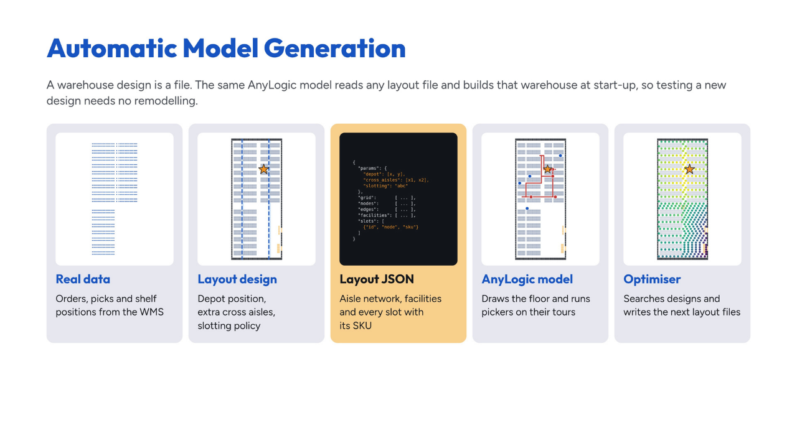
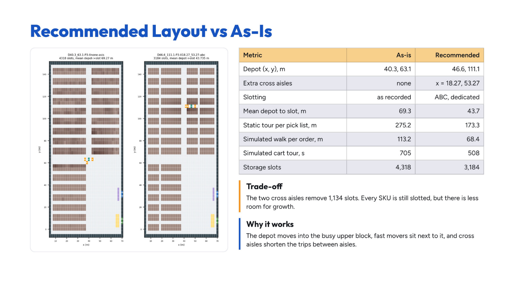
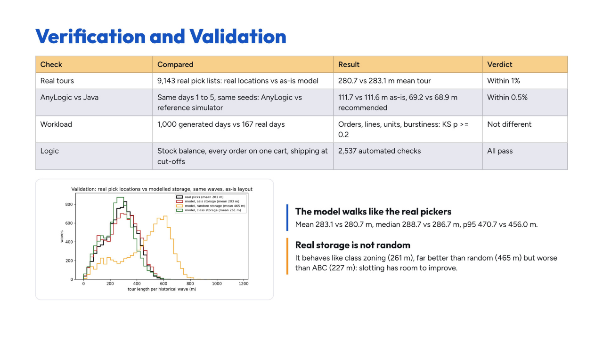
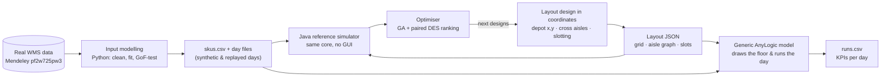
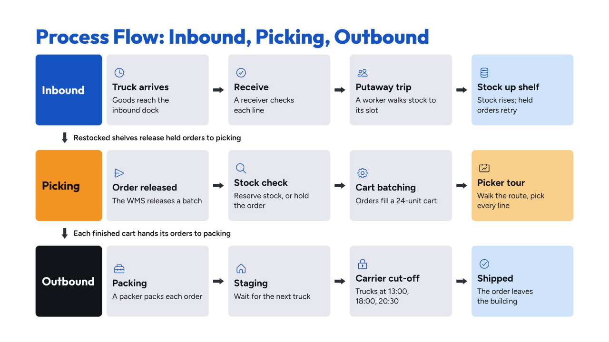
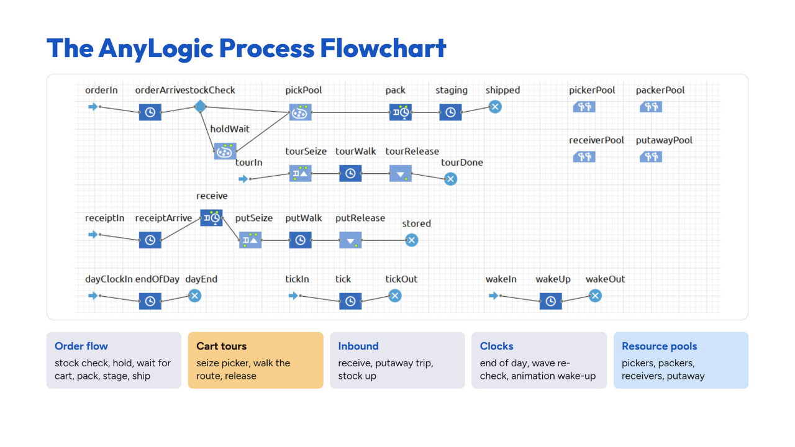
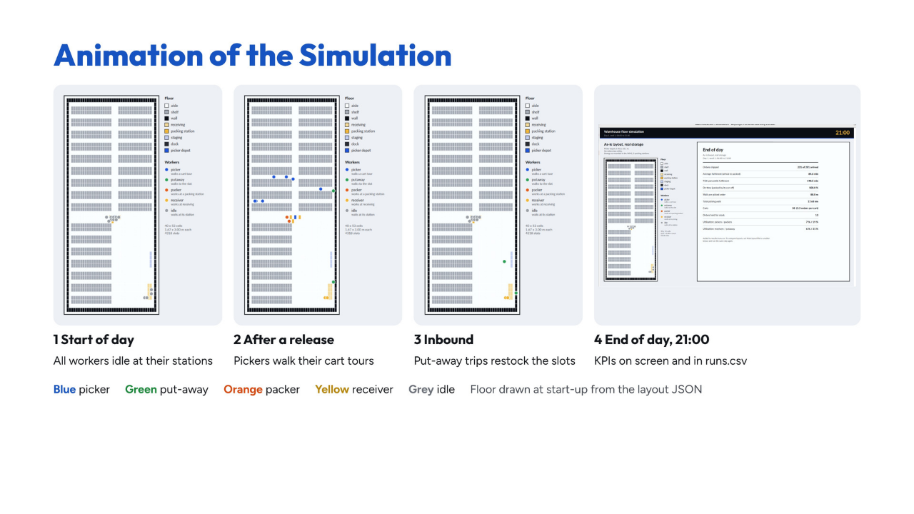
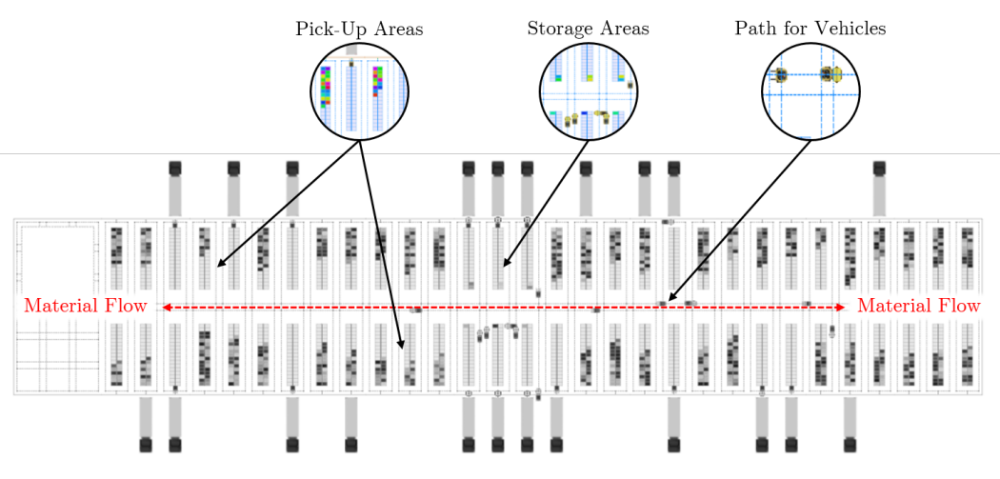

<div align="center">

# Order-Fulfilment Warehouse Simulation

### From raw WMS data to an automatically generated AnyLogic model and simulation-based layout optimisation of a real footwear warehouse

**IE305 Simulation Lab · IEOR, IIT Bombay**

Shivam Soni (24B4525) · Siddhesh Phadke (24B4502)


-2e7d32)

[**Slide deck (Canva)**](https://canva.link/39nugz68ncp23jvh) ·
[**Final report**](warehouse-sim/reports/REPORT.md) ·
[**Original proposal (PDF)**](docs/proposal/proposal_v2_intra_warehouse.pdf) ·
[**Explained simply**](warehouse-sim/docs/EXPLAINED_ELI5.md)

</div>

---



## In one paragraph

Warehouses usually place their pick-up point and aisles, slot their products and set their staffing by habit, and every new layout normally needs a new simulation model. We built **one generic AnyLogic model that builds the warehouse itself at start-up from a layout file**. We fed it the **real data of a footwear manufacturer's warehouse** (122k order lines, 215k picked units, 2,292 storage locations). We **validated** it against the real pickers' tours, to within 1%. Then a **genetic algorithm plus discrete-event simulation** searched for a better design. The recommended layout **cuts walking per order by 40%**, and the gain holds on replayed historical days and when we vary our assumed pick time.

## Headline results

| | As-is | Recommended | Change |
|---|---:|---:|---:|
| Pick-up / drop-off point (depot), m | (40.3, 63.1) | (46.6, 111.1) | moved into the busy upper block |
| Extra cross aisles | none | x = 18.27, 53.27 m | +2 |
| Slotting | as recorded | ABC, dedicated | by turnover |
| Static tour per real pick list | 275.2 m | 173.3 m | **−37%** |
| Simulated walk per order | 113.2 m | 68.4 m | **−40%** |
| Simulated cart tour | 705 s | 508 s | −28% |
| Storage slots | 4,318 | 3,184 | −1,134 (every SKU still slotted) |

- **Validation:** the as-is model walks 283.1 m per real pick list against 280.7 m for the real pickers (within 1%). AnyLogic and the Java reference simulator agree within 0.5%.
- **Real days:** on 10 replayed historical days, walk per order falls by **27.2 ± 5.9 m** and fulfilment time by **127 ± 30 s** (paired comparison, Bonferroni 95% CI).
- **Staffing:** **3 pickers with 36-unit carts** is the fewest pickers that meets the service target (on time ≥ 95%, p95 fulfilment ≤ 2 h), with the least walking.
- **Robustness:** the saving stays at 2.3 to 2.5 min per order whether picking takes 6, 12 or 18 s per line. It is significant in all three cases.

<table>
<tr>
<td width="50%"></td>
<td width="50%"></td>
</tr>
<tr>
<td align="center"><sub>Recommended layout vs as-is</sub></td>
<td align="center"><sub>The model walks like the real pickers</sub></td>
</tr>
</table>

## How it works



1. **Input data analysis** (Python). We cleaned the WMS extract and fitted distributions, testing each with chi-square, KS and Anderson–Darling (bootstrap p-values). A distribution was used only when it passed; otherwise the model resamples the real data. For example, orders per day follow NegBin(2.38, 0.0122) because Poisson was rejected. Order baskets are an empirical bootstrap, because every parametric fit failed.
2. **Layout design** (Python). A design is a small dictionary: depot (x, y), extra cross-aisle positions and a slotting policy. It is applied to the real building, rebuilt from `Storage_Location.csv`, and compiled to a layout JSON.
3. **Model building** (AnyLogic + Java). One `.alp` file, itself generated by a Python script. At start-up `Main.setup()` reads the layout, the run settings, the SKU master and the day's orders. It then sizes the resource pools, draws the floor and feeds a fixed Process Modeling Library flowchart. **Changing the warehouse means changing a file, not the model.**
4. **Output analysis** (AnyLogic experiments). These compare layouts, replay real days, and sweep staffing and cart size, using common random numbers throughout.
5. **Optimisation** (Python + Java). A depot scan plus a genetic algorithm over the design screens 971 designs on the real pick lists. The best designs then go to full simulation, with paired, Bonferroni-corrected ranking, staffing sweeps and a stress test.

<details>
<summary><b>The process inside the model</b></summary>




</details>

<details>
<summary><b>Animation</b></summary>



</details>

## From proposal to final project

The project started from a more general idea: a **generic simulation framework for warehouse handling systems with automatic model generation**. The full proposal is in [`docs/proposal/`](docs/proposal/).



The core idea survived. **The warehouse is described by a file, and the simulation model is generated from it, so testing a layout is a one-click experiment instead of a modelling task.** Choosing a real dataset moved the rest of the project onto firmer ground:

| | Original proposal | What we built |
|---|---|---|
| **System** | Generic handling system: docks, forklifts, pallets, trucks, charging | E-commerce each-picking: pickers with carts, packing, staging, carrier cut-offs, inbound putaway |
| **Input data** | Synthetic distributions | Real WMS extract of a footwear warehouse, fitted and goodness-of-fit tested |
| **Model generation** | Block matrix (D / F / P / 0) → space markup and paths built at runtime | Design in coordinates → layout JSON (grid, aisle graph, slots) → the same AnyLogic model draws and runs it at start-up |
| **Layouts** | Stylised I, L, T, U, H shapes | The real building (864 bays, 17 aisles); the early I / L / U template prototype is kept in `warehouse-sim/model/WarehouseSim/results/archive_old_template_model/` |
| **Resources** | Forklift fleet, docks, chargers, breakdowns | Pickers, packers, receivers, putaway workers |
| **Optimisation** | OptQuest: fewest forklifts subject to p95 turnaround | Free AnyLogic PLE only, so the search runs on the shared Java core: GA screen → paired DES ranking → staffing and cart-size sweep → stress test |
| **KPIs** | Truck turnaround, forklift travel, carbon | Walk per order, fulfilment time, on time vs cut-off, utilisation, held orders |

The reasoning behind each keep, change or cut is in [`docs/PROJECT_SPEC.md`](docs/PROJECT_SPEC.md).

## Repository map

```
SimLab/
├── README.md                     ← you are here
├── docs/
│   ├── proposal/                 original project proposal (LaTeX source + PDF)
│   ├── presentation/             final slide deck (Canva link + all 20 slides)
│   └── PROJECT_SPEC.md           design spec v0.2: what we kept, changed and cut
└── warehouse-sim/                the project itself
    ├── data_raw/mendeley/        the real dataset, untouched
    ├── data/real/                cleaned tables (bays, waves, as-is slotting, basket pool)
    ├── python/whsim/             input models, layout compiler, validation, optimiser, reports
    ├── java/src/wh/              shared simulation core: routing, batching, inventory, KPIs, RefSim
    ├── anylogic/build_model.py   writes the AnyLogic model file
    ├── model/WarehouseSim/       the AnyLogic model + everything it reads at start-up
    ├── reports/                  final report, input analysis, audit, validation, optimisation
    ├── results/                  optimiser and reference-simulator outputs
    ├── tools/                    check.sh (all tests + model verification) and helpers
    └── docs/EXPLAINED_ELI5.md    the whole project, explained simply
```

## Reports

| Report | What's inside |
|---|---|
| [Final report](warehouse-sim/reports/REPORT.md) | Scope, data, model, results, what-ifs, optimisation, recommendation, limitations |
| [Input analysis](warehouse-sim/reports/input_analysis.md) | Cleaning log, statistics, fitted distributions with GoF tests, validation of the workload generator |
| [Input audit](warehouse-sim/reports/input_audit.md) | Independence, seasonality, bootstrap Anderson–Darling, SKU-mix drift, picker heterogeneity |
| [Validation](warehouse-sim/reports/validation.md) | As-is model vs the real pick locations |
| [Optimisation](warehouse-sim/reports/optimization.md) | The four optimisation stages, with figures |
| [Explained simply](warehouse-sim/docs/EXPLAINED_ELI5.md) | A plain-language walk through the project |

## Run it

You need Python 3 with `numpy`, `scipy`, `pandas` and `matplotlib`, a JDK, and [AnyLogic 8.9](https://www.anylogic.com/) (the free PLE is enough).

```bash
cd warehouse-sim/python
python3 -m whsim.cli scenarios       # fit input models, write skus.csv + day files
python3 -m whsim.validate            # as-is model vs real tours
python3 -m whsim.optimize            # simulation-based optimisation (~10 min)
cd .. && tools/check.sh              # all tests + generate and verify the AnyLogic model
```

Then open `warehouse-sim/model/WarehouseSim/WarehouseSim.alp` in AnyLogic and run **Simulation**, **CompareLayouts**, **ValidateRealDays**, **StaffPickers** or **CartSize**. The full command list and the meaning of every experiment and parameter are in [`warehouse-sim/README.md`](warehouse-sim/README.md).

## Limitations

- The data has no timestamps for pick, pack or receive steps, so those times are assumptions. The what-ifs vary them. The same goes for inbound volumes and opening stock.
- Dock and packing-area positions are assumed (the rack-free lower-right quarter).
- One floor, one shift, no picker congestion in the aisles, and nearest-neighbour routing rather than an optimal TSP tour.

## Acknowledgements

- **Data:** R. Furlan de Assis, *Order Picking Dataset from a Warehouse of a Footwear Manufacturing Company*, Mendeley Data, v1, 2024. [doi:10.17632/pf2w725pw3.1](https://doi.org/10.17632/pf2w725pw3.1) (CC BY 4.0).
- **Inspiration for automatic model generation:** L. Jurgeleit, M. Mowe, M. Kiefer, C. Schumacher and U. Clausen, *Automatic model generation for discrete event simulation of less-than-truckload terminals*, Proc. Winter Simulation Conference, 1493–1504, 2024.
- Built for **IE305 Simulation Lab**, Department of Industrial Engineering and Operations Research, IIT Bombay.
