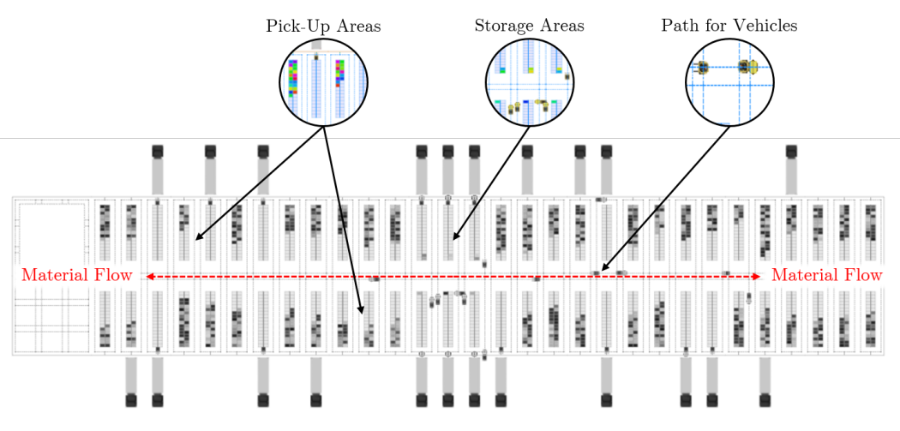

# Original project proposal

**A Generic Simulation Framework for Intra-Warehouse Operations with Automatic Model Generation**
Shivam Soni (24B4525), Siddhesh Phadke (24B4502). IE305 Simulation Lab, IEOR, IIT Bombay.

This folder holds the proposal we started from, before we chose the real dataset. The [main README](../../README.md#from-proposal-to-final-project) shows how the final project grew out of it.

| File | What it is |
|---|---|
| [`proposal_v2_intra_warehouse.pdf`](proposal_v2_intra_warehouse.pdf) | **Revised proposal**: scope narrowed to operations inside the warehouse (receiving → putaway → picking → staging → loading). Forklifts *and* workers; picking and loading strategies; carbon KPI. |
| [`proposal_v1_handling_system.pdf`](proposal_v1_handling_system.pdf) | First draft: a whole warehouse handling system, including trucks, the yard queue and dock assignment. |
| `*.tex`, [`selfArx.cls`](selfArx.cls), [`idea_warehouse.png`](idea_warehouse.png) | LaTeX sources. Compile either `.tex` with `selfArx.cls` and the figure in the same folder (`pdflatex`, run twice). |

## The original approach in brief

**Problem.** Managers decide by rule of thumb where storage and pick-up areas go, how material is routed, how many forklifts and workers to run and which strategies to use. Every new layout normally needs a new simulation model, built by an expert.

**Idea.** Build one generic, parameter-driven discrete-event model of a warehouse that a non-expert can configure. On top of it, build an **automatic model generator**: the user fills a grid of building blocks (D = dock block, F = forklift block, P = passage, 0 = empty). The generator then creates the space markup, walls, docks, storage and pick-up areas and the forklift path network **at runtime**. Any facility shape (I, L, T, U, H) becomes a one-click experiment.

**Three components.**
- *User interface*: set layout, docks, forklifts, volume and policies; read a KPI dashboard.
- *Generic modelling framework*: reusable blocks (dock, forklift/charging, passage) and generic agents.
- *Data and model assembly*: configurations and input distributions in, runnable model and results out.

**Planned study.**
1. Allotment and material flow: where storage and pick-up areas sit, and how paths are routed.
2. Resources: the fewest forklifts and workers that meet the service level at peak, and which one is the bottleneck.
3. Strategies: the gain from storage, picking and loading rules at zero capital cost.
4. Usability: whether one generated model can answer all of this without rebuilding.

**Planned optimisation (OptQuest).** Minimise forklifts and workers subject to p95 shipment cycle time ≤ T\* and zero buffer overflow. Then minimise forklift travel and carbon through allotment, path design and strategy.

## What changed, and why

We found a **real WMS extract** of a footwear warehouse with orders, picks and storage coordinates all from one site, and rebuilt the project around it:

- **The core idea was kept:** a layout is a file, and the AnyLogic model is generated from it at runtime. The block matrix became a *design in coordinates* (depot, cross aisles, slotting) compiled to a layout JSON.
- **The system became each-picking:** walking pickers with carts, packing stations and carrier cut-offs replaced forklifts, pallets and docks. The data describes that system.
- **Synthetic inputs became fitted, tested input models**, with real days replayed for validation.
- **OptQuest became our own optimiser.** The free AnyLogic PLE was a hard constraint, so a genetic algorithm and paired simulation ranking run on the same Java core that AnyLogic embeds.

Each decision is worked through in [`../PROJECT_SPEC.md`](../PROJECT_SPEC.md).
