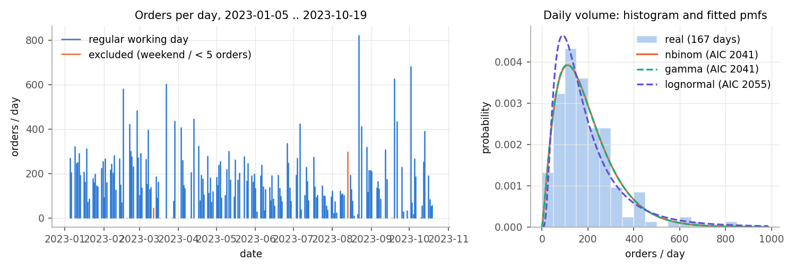
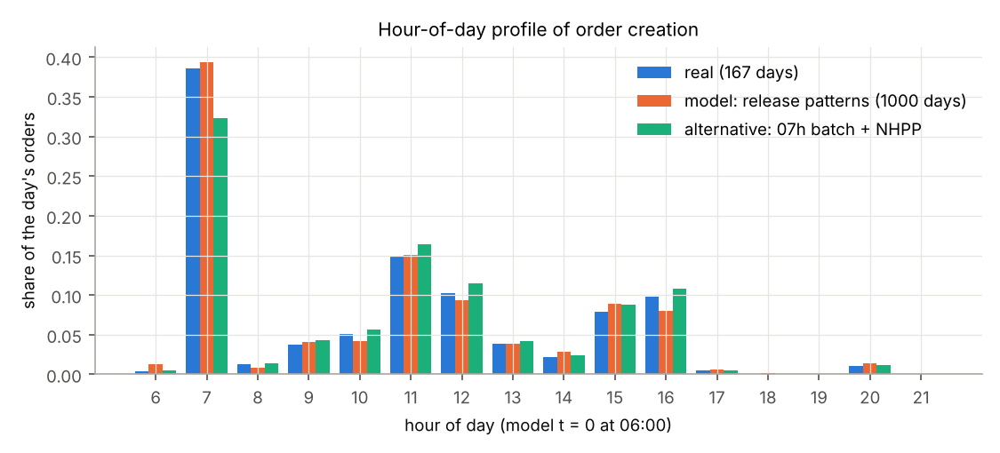
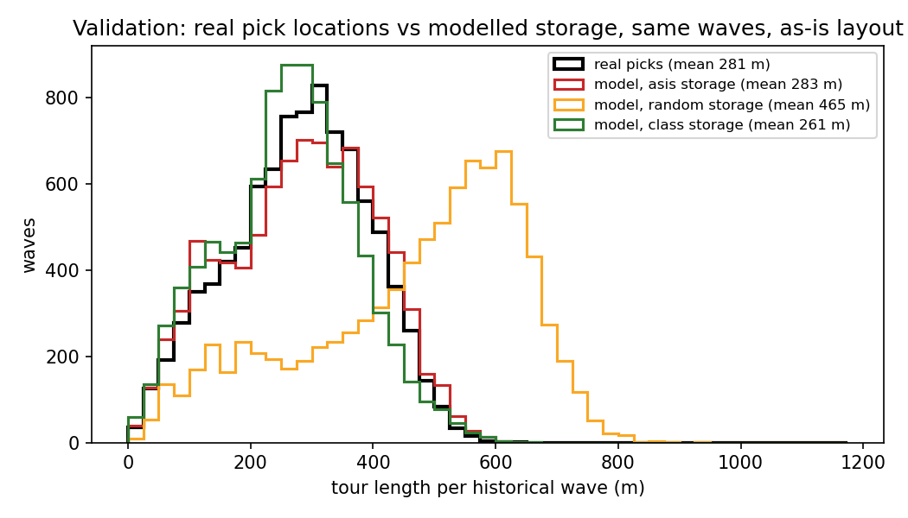
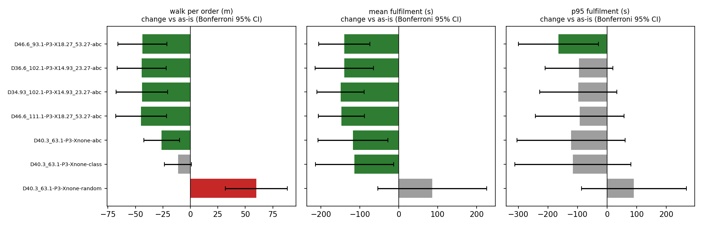
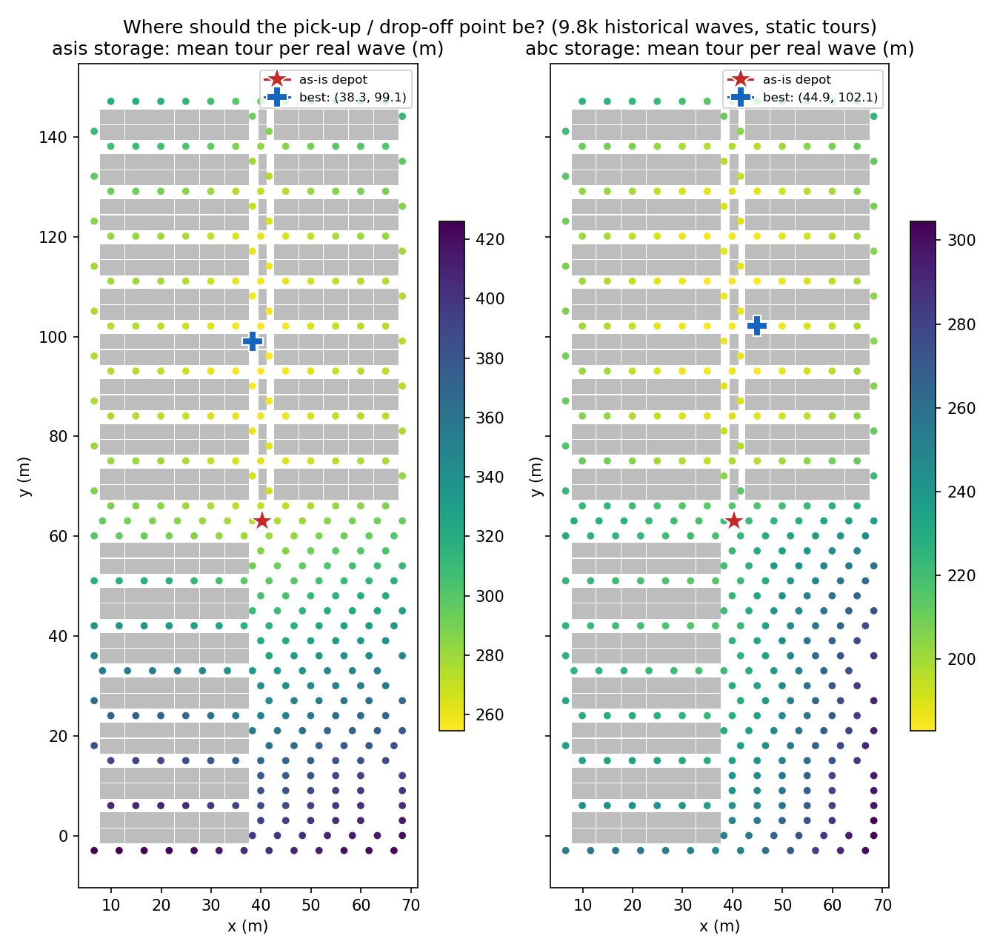
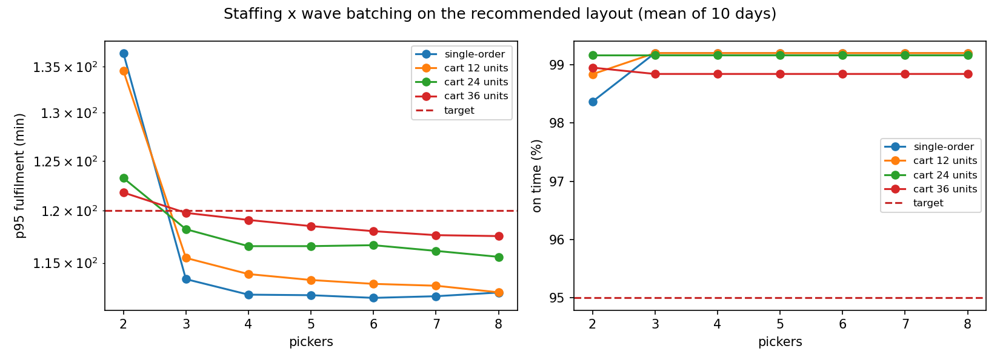

# Footwear order-fulfilment warehouse: simulation, automatic model generation and layout optimisation

IE305 Simulation Lab, IEOR IIT Bombay. Data: real WMS extract of a footwear manufacturer's warehouse (Mendeley Data pf2w725pw3 v1, 2023, CC BY 4.0). Companion reports: [input analysis](input_analysis.md), [validation](validation.md), [optimisation](optimization.md).

## 1. Scope and objectives

**System.** One floor (Z = 1) of a real footwear warehouse: 2,292 storage locations in 864 shelf bays, 17 picking aisles and 3 cross aisles, a central pick-up / drop-off point (depot). Customer orders are released by the WMS in batches; pickers push carts of about 24 pairs (a *wave*) along a route through the aisles, drop the cart at a packing station; packed orders wait in staging for the next carrier cut-off. Inbound trucks are received, put away and restock the shelves; an order is released to picking only when all its lines are in stock.

**Objectives.** (1) Build a generic, data-driven AnyLogic model that is *generated automatically* from a layout file. (2) Reproduce the as-is warehouse from its data and validate it. (3) Find better layouts and operating policies by simulation-based optimisation: where the depot is, where to add cross aisles, how to slot SKUs, how many pickers, what cart size.

**Boundary and key assumptions.**

| included | excluded / assumed |
|---|---|
| order release, stock check / hold, wave batching, picker routing, packing, staging, cut-offs | yard, trucks outside the dock, returns, value-added services |
| receiving, putaway trips, SKU-level inventory | inbound volumes and opening stock (no data: assumed top-up rule, sensitivity) |
| real building geometry, real orders, real storage (as-is) | pick / pack / receive times (no timestamps: literature values, varied in the what-ifs) |
| picker / packer / receiver / putaway resources | docks, receiving and packing area positions (no data: rack-free lower-right quarter) |
| one zone, one floor, single shift 06:00-21:00 | carrier cut-offs 13:00, 18:00, 20:30 (assumed); no congestion between pickers |

## 2. Data and input analysis

Source files: 122,370 order lines (32,621 orders, 2,515 SKUs = reference x size) on 178 days, 215,192 picked units in 9,707 historical waves, 2,292 located storage positions. Full analysis with cleaning log, statistics and every test: [input_analysis.md](input_analysis.md).

| input | real / assumed | model (test result) |
|---|---|---|
| orders per day | real | negative binomial, mean 193.2; Poisson rejected (dispersion ~88), NB passes chi-square and bootstrap KS |
| arrivals within the day | real | WMS batch releases (1-5 per day, ~2.8 min long); Poisson arrivals rejected (KS, dispersion); release patterns resampled from the 15 most similar real days |
| order baskets (SKUs, quantities) | real | bootstrap of real orders (+-3 days window); all parametric fits rejected, heavy tails (max 340 SKUs, 2,400 units) |
| SKU popularity | real | 21% of SKUs make 80% of lines |
| storage (as-is) | real | each SKU on the bay it was really picked from most often (70.6% of its picks are there) |
| cart size, wave formation | real | 61% of real waves carry exactly 24 units -> 24-unit carts, first-fit, wave release (full cart or 15 min) |
| staff | real (range) | 6.6 operators active per day (1-11) -> 7 pickers as-is |
| pick time / line, pack, receive, putaway | assumed | lognormal 12 s/line; triangular(40,60,120) s + 4 s/unit; varied x0.5 / x1.5 |
| inbound + opening stock | assumed | truck every 2 h, top-up rule; opening stock covers q90 of a selling day |

Validation of the workload generator (1,000 synthetic vs 167 real days): daily volume, lines, units, lines/order and the burstiness of the releases are not significantly different (two-sample KS, see input_analysis.md section 7; checks of the input assumptions in input_audit.md).

## 3. Model building

**Automatic model generation.** A layout is a *design in coordinates* (depot x, y; extra cross-aisle x positions; slotting policy). `whsim.design` builds the real building from `Storage_Location.csv` on a grid of 5/3 m x 3 m cells (every bay on its own cell, error <= 0.37 m), applies the design, validates it (connectivity, every shelf reachable, enough slots) and compiles it to a layout JSON (aisle graph, facilities, slots with their SKU). The AnyLogic model (`model/WarehouseSim/WarehouseSim.alp`) is the same for every layout: at start-up `Main.setup()` reads the layout, the run configuration and the day file, sizes the resource pools, *draws the warehouse from the JSON* and feeds the orders into a fixed flowchart. Changing the warehouse means changing a file, not the model.

**Process logic (Process Modeling Library).** Order: arrival delay -> stock check (SelectOutput; short -> Wait until a putaway brings the stock) -> pick pool (Wait) -> *cart*: `PickTour` agents formed by `Main.dispatch()` (first-fit up to 24 units, released when full or after 15 min) -> Seize picker -> tour (Delay = nearest-neighbour route over all the cart's slots, then packing station, then depot) -> Release -> orders go to packing (Service) -> staging until the next cut-off -> Sink. Receipt: arrival -> receive (Service) -> Seize putaway worker -> trip dock-slot-dock -> stock up and release held orders.

**Design choices and innovative features.**

- *Layouts in coordinates and a JSON interface*: the optimiser, the tests and AnyLogic all read the same compiled file.
- *Real geometry and real storage*: the as-is model uses the dataset's building and the SKU locations observed in 215k picks, not a stylised warehouse.
- *Shared Java core*: routing, batching, inventory and KPI code (`java/src/wh`) is embedded unchanged in the AnyLogic model and used by a plain-Java reference simulator (`RefSim`) that the optimiser calls thousands of times.
- *Common random numbers per order*: every service time comes from a stream seeded by (seed, stream, order), so designs are compared on identical work - paired comparisons with tight confidence intervals.
- *Oversize orders* are split into cart-sized trips the way the real WMS splits them over waves.

**Verification.** 30 Python tests and 2,500+ Java checks (`tools/check.sh`): distributions vs their formulas, independence of the random streams, batching rules, inventory balance, Java route = Python route to the last bit on every order of every layout, full simulated days with conservation checks; every Java snippet of the AnyLogic model is compiled against the AnyLogic 8.9.10 engine and the model file is loaded by AnyLogic's own serializer.

**Validation against reality.** The 9,143 historical waves routed over their *real* pick locations versus the same waves in the model's as-is layout:

| tours of the same historical waves | mean (m) | median (m) | p95 (m) |
|---|---|---|---|
| real pick locations | 280.7 | 286.7 | 456.0 |
| model, asis storage | 283.1 | 288.7 | 470.7 |
| model, random storage | 464.5 | 508.0 | 694.0 |
| model, class storage | 261.1 | 266.0 | 443.3 |
| model, abc storage | 226.9 | 226.0 | 400.0 |

The as-is model reproduces the real tour lengths within 1%; the real storage is close to class-based (A/B/C zones), far from random.

## 4. Output analysis (basic): KPIs and the as-is warehouse

KPIs per simulated day: walking per order (m, the order's share of its cart tour), tour time, fulfilment time (arrival -> packed; mean and p95), on-time % (packed before the due cut-off, due = first cut-off >= arrival + 1 h), held orders (stock-outs), utilisation of each resource, carts and units per cart.

**Real-day replay** - the 10 historical days (20230120, 20230203, 20230306, 20230421, 20230501, 20230620, 20230711, 20230828, 20230901, 20231003), as-is vs recommended layout:

| KPI (mean of 10 real days) | as-is | recommended | paired difference (Bonferroni 95% CI) |
|---|---|---|---|
| walk per order (m) | 69.3 | 42.1 | -27.2 +- 5.9 |
| fulfilment mean (s) | 3,246.1 | 3,119.5 | -126.6 +- 29.8 |
| fulfilment p95 (s) | 6,147 | 6,102 | |
| on time (%) | 91.2 | 91.4 | |
| cart tour (s) | 588 | 432 | |
| orders per cart | 5.96 | 5.93 | |
| units per cart | 28.6 | 28.4 | |
| picker utilisation | 0.05 | 0.04 | |
| packer utilisation | 0.16 | 0.16 | |
| held orders per day | 13.0 | 13.0 | |

Per real day, as-is layout:

| day | orders | first release | on time (%) | held orders | mean hold (min) | fulfil p95 (min) | picker utilisation |
|---|---|---|---|---|---|---|---|
| 2023-01-20 | 87 | 07:33 | 100.0 | 0 | - | 53 | 0.02 |
| 2023-02-03 | 161 | 07:35 | 100.0 | 1 | 29 | 107 | 0.04 |
| 2023-03-06 | 266 | 07:01 | 75.2 | 17 | 42 | 111 | 0.08 |
| 2023-04-21 | 105 | 07:16 | 100.0 | 1 | 13 | 42 | 0.03 |
| 2023-05-01 | 185 | 07:20 | 100.0 | 0 | - | 70 | 0.06 |
| 2023-06-20 | 135 | 15:50 | 100.0 | 3 | 25 | 93 | 0.03 |
| 2023-07-11 | 230 | 07:13 | 100.0 | 13 | 50 | 84 | 0.08 |
| 2023-08-28 | 320 | 11:30 | 36.9 | 24 | 263 | 252 | 0.12 |
| 2023-09-01 | 211 | 07:14 | 100.0 | 71 | 29 | 159 | 0.04 |
| 2023-10-03 | 71 | 07:17 | 100.0 | 0 | - | 53 | 0.01 |

Late orders concentrate on the days where a large WMS release comes shortly before a cut-off and on held orders waiting for inbound stock (the inbound rule is an assumption); on the other days every order is on time.

Interpretation: utilisation over the whole day is low, but fulfilment takes about an hour because most of a day's orders are released in one or two WMS batches; the picking queue after a release, not the average load, drives fulfilment time. Shorter tours shorten that queue.

## 5. Output analysis (advanced): alternatives, what-ifs, optimisation

**Alternatives on 10 synthetic days (common random numbers).**

| design | walk / order (m) | tour (s) | fulfil mean (s) | fulfil p95 (s) | on time (%) | walk vs as-is (Bonferroni 95% CI) |
|---|---|---|---|---|---|---|
| D40.3_63.1-P3-Xnone-asis (as-is) | 113.2 | 705 | 3,716 | 7,061 | 99.1 |  |
| D40.3_63.1-P3-Xnone-random | 173.3 | 975 | 3,803 | 7,152 | 99.4 | +60.1 +- 28.2 |
| D40.3_63.1-P3-Xnone-class | 101.9 | 660 | 3,603 | 6,945 | 99.5 | -11.3 +- 12.3 |
| D40.3_63.1-P3-Xnone-abc | 87.1 | 593 | 3,599 | 6,939 | 99.5 | -26.1 +- 16.2 |
| D46.6_111.1-P3-X18.27_53.27-abc **(recommended)** | 68.4 | 508 | 3,569 | 6,968 | 99.2 | -44.8 +- 23.1 |
| D34.93_102.1-P3-X14.93_23.27-abc | 69.1 | 509 | 3,567 | 6,963 | 99.2 | -44.1 +- 23.4 |
| D36.6_102.1-P3-X14.93_23.27-abc | 69.0 | 508 | 3,577 | 6,966 | 99.2 | -44.2 +- 22.3 |
| D46.6_93.1-P3-X18.27_53.27-abc | 69.6 | 517 | 3,577 | 6,897 | 99.4 | -43.6 +- 22.4 |

**Simulation-based optimisation.** Stage 1 screens designs on the real workload (mean tour of the 9,707 historical waves): a depot scan over every third open cell and a genetic algorithm over depot (x, y), up to two extra cross aisles and the slotting policy (251 designs evaluated). Stage 2 simulates the best distinct designs and the as-is variants on the same 10 days and ranks them with paired, Bonferroni-corrected comparisons. Details: [optimization.md](optimization.md).

**What-if: pickers x cart size** (recommended layout, 10 days each).

Fewest pickers meeting on-time >= 95% and p95 fulfilment <= 120 min, then least walking: **3 pickers, 36-unit carts** (on time 98.8%, p95 120 min, 9.1 km walked per day).

**What-if: pick time per line** (assumed input), as-is vs recommended:

| pick time x | as-is fulfil (s) | recommended fulfil (s) | difference (95% CI) | as-is walk/order | recommended walk/order |
|---|---|---|---|---|---|
| 0.5 | 3,656 | 3,518 | -138 +- 35 | 113.5 | 68.6 |
| 1.0 | 3,716 | 3,569 | -147 +- 39 | 113.2 | 68.4 |
| 1.5 | 3,760 | 3,621 | -139 +- 66 | 112.7 | 68.4 |

## 6. Animation

Run the **Simulation** experiment in AnyLogic (8.9, free PLE): the warehouse is drawn at start-up from the layout JSON (aisles, racks, docks, receiving, packing stations, depot); worker dots move along the real aisle network (red pickers on their cart tours, blue putaway workers, orange packers, yellow receivers; grey = idle); a status panel and a time plot show orders in system, held orders, staging and the receiving buffer. Set `Main.layoutFile` to `data/layouts/D46.6_111.1-P3-X18.27_53.27-abc.json` to watch the recommended layout, `Main.realDay` = 1..10 to replay a historical day. Static previews of every layout: `build/previews/` (`python3 -m whsim.render`).

## 7. Recommendation

1. **Re-slot by pick frequency (ABC, dedicated)** and **move the pick-up / drop-off point to (46.6, 111.1) m** with **extra cross aisles at x = 18.27 m, x = 53.27 m** (design `D46.6_111.1-P3-X18.27_53.27-abc`): walking per order 113.2 -> 68.4 m (-40%), cart tours 705 -> 508 s; the gain holds on the 10 real days and for pick times from half to one and a half times the assumed value.
2. Re-slotting alone is the cheap first step (no construction): see the as-is x storage-policy rows above.
3. **Staff 3 pickers with 36-unit carts** on the new layout if the service targets above are the goal; add pickers only for the morning release, which drives fulfilment time.
4. Before acting: measure pick, pack and receiving times (the model's main assumed inputs) and the dock/packing area positions, and rerun `whsim.optimize`; extend to the other floors (Z2-Z4) and to picker congestion.

## 8. Limitations

- Service times, inbound and opening stock are assumptions (no timestamps or receipts in the data).
- The dock / packing area position is assumed; extra cross aisles remove storage slots (the design keeps every SKU slotted, but capacity for growth is lower).
- No congestion between pickers in the aisles; one floor only; nearest-neighbour routing (not optimal TSP).
- The AnyLogic model was verified by compilation and serializer loading here; its runs should be compared with the reference simulator results in `results/opt/` (small differences from simultaneous-event ordering are expected).
