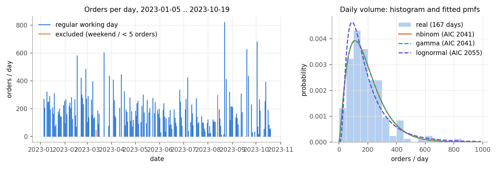
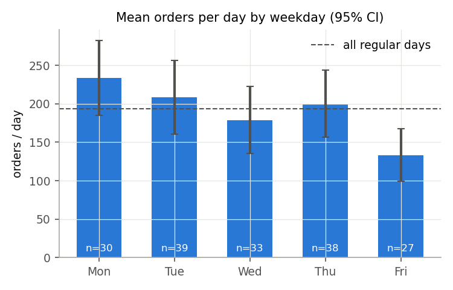
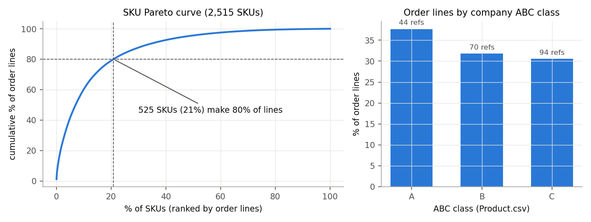
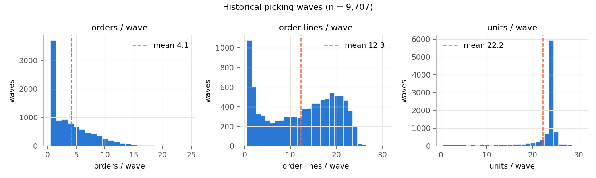
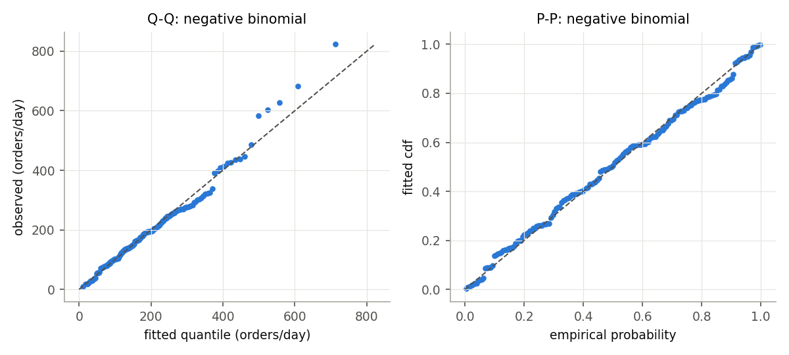
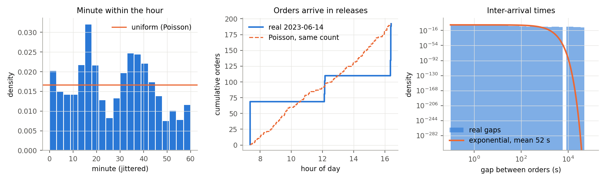
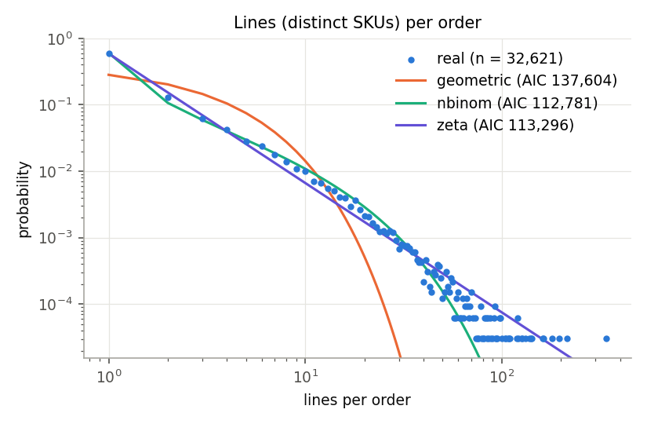
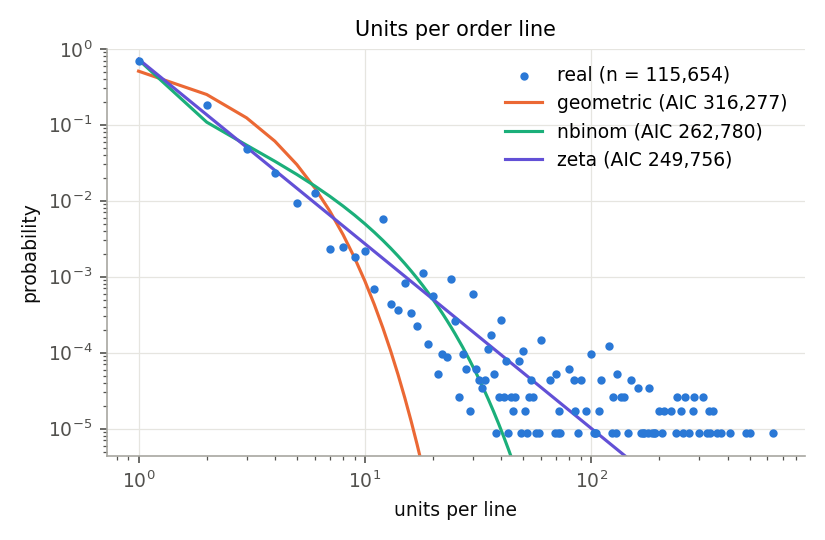
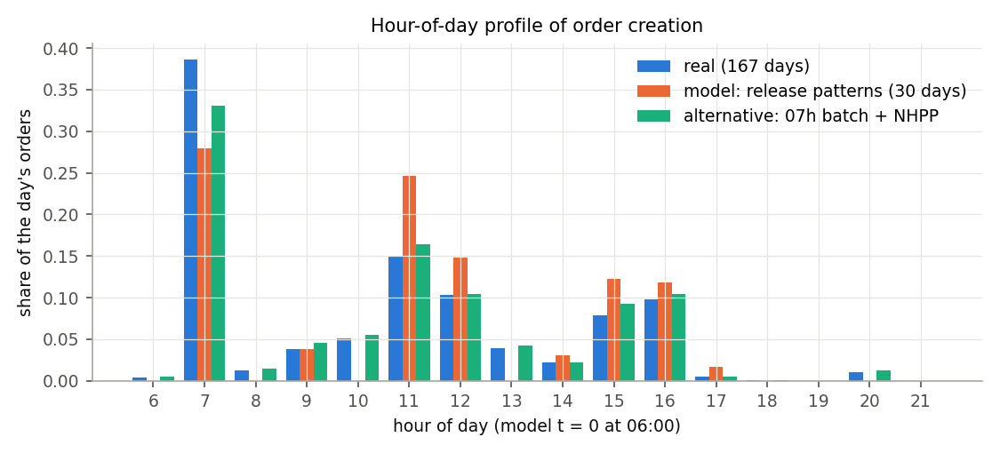
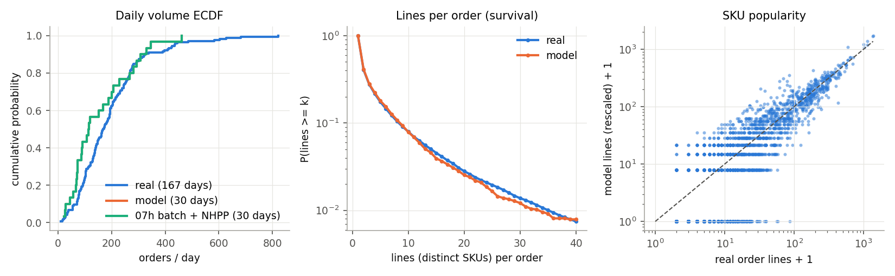

# Input data analysis: footwear order-fulfilment warehouse

IE305 Simulation Lab. Generated by `python3 -m whsim.input_report` from the raw data and `model/WarehouseSim/data/config/input_models.json` (written by `python3 -m whsim.input_models`). Do not edit by hand.

**Source.** R. Furlan de Assis, *Order Picking Dataset from a Warehouse of a Footwear Manufacturing Company*, Mendeley Data v1 (2024), doi:10.17632/pf2w725pw3.1, licence CC BY 4.0. A real WMS extract (anonymised references, customers and operators) of a footwear manufacturer's warehouse, 2023-01-05 to 2023-10-19.

**Time origin.** Model time t = 0 is 06:00 of the simulated day; all times are seconds. **Units.** Storage coordinates in the raw file are decimetres (converted to metres here).

## 1. Data dictionary

| file | content | used for |
|---|---|---|
| Customer_Order.csv | 122,370 order lines: customer, order number, line sequence, reference, size, quantity, creation time (minute), wave, operator | arrivals, daily volume, baskets, SKU mix |
| Picking_Wave.csv | 215,192 rows, one per unit picked: wave, reference, size, location, operator | historical pick lists (`data/real/waves.csv`), reconciliation check of the size rule |
| Product.csv | 208 references with the company ABC class and sector | ABC shares (report) |
| Storage_Location.csv | 2,292 locations, aisles A..R, x/y/z (decimetres; z = level 1..4) | building size for the layout (x 8.6..66.6 m, y 0.0..144.0 m) |
| Random/Class_Based/Dedicated/Hybrid_Storage.csv | location -> up to 18 'reference;value' slots per location for four storage policies proposed by the data authors | not used as input (policy benchmarks of the data authors); the layout optimiser decides its own slotting |
| Support_Points_Navigation.csv, Layout_Z1.0.pdf | aisle navigation points and CAD drawing | not used |

**Not in the data:** pick/pack/receipt timestamps, inbound trucks and receipts, stock levels, shift times. Those inputs are assumptions (table 2) and are treated as sensitivity parameters.

## 2. Every model input: real or assumed

| input | source | model |
|---|---|---|
| orders per day | real | negative binomial r = 2.38, mean 193.2 (167 regular days) |
| day-of-week effect | real | multiplicative factors (optional `weekday=`; day files are pooled) |
| order release times within the day | real | empirical release patterns of the 15 days with closest volume (batch releases) |
| basket: SKUs + qty of each order | real | window bootstrap of 32,621 real orders (+-3 days around the pattern day) |
| SKU mix (skus.csv weight) | real | share of order lines per SKU over the whole period |
| historical pick waves (optimiser workload) | real | 9,707 waves in `data/real/waves.csv` |
| opening stock (skus.csv init_qty) | **assumed** | max(2, ceil(1.5 x mean daily units), ceil(q90 of units on selling days)) - section 6 |
| inbound trucks / receipts | **assumed** | truck every 2 h from 07:00; top-up rule with a 2-h order book |
| pick time per line (search + grab + confirm) | **assumed** | lognormal mean 12 s, sd 5 s (run_config); literature 5-30 s per line; sensitivity parameter |
| pack time | **assumed** | triangular(40, 60, 120) s per order + 4 s per unit (run_config) |
| receiving / put-away handling | **assumed** | gamma(4, 12) s per receipt line; uniform(20, 40) s handling |
| walking speed | **assumed** | 1.0 m/s with cart (literature ~0.6-1.3 m/s); put-away 1.2 m/s |
| staff levels | real (range) / design | 1-11 operators active per day in the data (mean 6.6); the model's pickers are a decision variable |

Pick time per line cannot be estimated: the extract has no pick timestamps. The literature on manual picker-to-parts picking (e.g. Tompkins et al., *Facilities Planning*; de Koster, Le-Duc & Roodbergen, EJOR 182(2), 2007) puts travel at about half of a picker's time and search + extraction at roughly a third; per-line search + extraction times of 5-30 s are typical. We keep 12 s and vary it in the sensitivity analysis. A data-derived *upper bound* is given in section 4.6.

## 3. Cleaning log

| rule | rows | action |
|---|---|---|
| C0 raw Customer_Order lines | 122,370 | read |
| C1 UTF-8 BOM on header | 1 | read with utf-8-sig |
| C2 trailing blanks in codCustomer | 122,370 | stripped |
| C3 half size written without decimal point (105 -> 10.5) | 38,846 | size / 10 |
| C4 empty size | 16 | dropped |
| C5 quantity 0 | 33 | dropped |
| C6 fully identical rows (split pick tasks) | 2,555 | kept |
| C6 repeated (order, SKU) lines | 6,667 | merged (qty summed) in baskets |
| clean order lines | 122,321 | kept |
| C7 dates with data | 178 | classified |
| C7 Saturday/Sunday dates | 5 | excluded from volume/arrival fits (348 orders kept in pool) |
| C7 weekday dates with < 5 orders (fragments) | 6 | excluded from volume/arrival fits (8 orders kept in pool) |
| C7 regular working days | 167 | used for fits |

**Why rule C3 is right.** Customer_Order writes half sizes without the decimal point (`105` = 10.5) while Picking_Wave and the storage files write `10.5`. After C3, every one of the 215,192 picked units matches an ordered (wave, SKU) cell: 107,187 of 112,418 (wave, SKU) cells agree exactly, 96 were picked short, 5,135 cells (12,718 units, 5.6% of ordered units) were never picked in their wave (probably short-picked / cancelled), and **no** unit was picked that was not ordered (0). Sizes >= 200 (reference PY5UPB only) are a different size scale and are kept as written in both files.

**Why identical rows are kept (C6).** Removing the 2,555 fully identical rows breaks the unit reconciliation above, so they are repeated pick tasks of one line, not export duplicates. In a basket they are merged into one line per SKU (qty summed).

**SKU definition.** SKU = (reference, size), id `<Reference>_<size>` with the size printed without trailing zeros (`8N10W9_9`, `8N10W9_9.5`, `PY5UPB_235`). 2,515 SKUs from 206 references.

## 4. Summary statistics

### 4.1 Daily volume (regular working days)

| quantity | n | mean | sd | CV | min | p5 | p25 | median | p75 | p95 | max |
|---|---|---|---|---|---|---|---|---|---|---|---|
| orders / day | 167 | 193.2 | 130.4 | 0.68 | 10.0 | 35.6 | 103.0 | 168.0 | 252.5 | 433.0 | 823.0 |
| lines / day | 167 | 686.2 | 489.4 | 0.71 | 12.0 | 93.3 | 351.5 | 597.0 | 899.0 | 1473.0 | 2953.0 |
| units / day | 167 | 1287.2 | 981.1 | 0.76 | 12.0 | 132.5 | 588.0 | 1083.0 | 1709.0 | 3051.3 | 5906.0 |
| orders / day, all 178 dates | 178 | 183.3 | 133.8 | 0.73 | 1.0 | 8.9 | 94.2 | 163.0 | 247.5 | 427.5 | 823.0 |

33 weekdays in the period have no orders at all (holidays / shutdowns / extraction gaps); the model simulates a working day, so they are not part of the volume distribution. The volume is very variable (CV 0.68), far beyond Poisson.

### 4.2 Orders, lines and units

| quantity | n | mean | sd | CV | min | p5 | p25 | median | p75 | p95 | max |
|---|---|---|---|---|---|---|---|---|---|---|---|
| lines (distinct SKUs) / order | 32621 | 3.5 | 7.6 | 2.16 | 1.0 | 1.0 | 1.0 | 1.0 | 3.0 | 14.0 | 340.0 |
| units / line | 115654 | 2.0 | 7.2 | 3.66 | 1.0 | 1.0 | 1.0 | 1.0 | 2.0 | 4.0 | 635.0 |
| units / order | 32621 | 7.0 | 40.6 | 5.80 | 1.0 | 1.0 | 1.0 | 2.0 | 4.0 | 24.0 | 2400.0 |
| waves an order is split over | 32621 | 1.2 | 1.7 | 1.35 | 1.0 | 1.0 | 1.0 | 1.0 | 1.0 | 2.0 | 100.0 |

Single-line orders: 59.5% of orders. 21 orders have more than 100 SKUs (max 340); they are 0.06% of orders but 2.7% of lines. They are real B2B orders and stay in the pool (flagged). 12.3% of orders were split over several waves by the WMS.

### 4.3 SKUs and ABC / Pareto

- 2,515 SKUs, 206 references, 1,334 SKUs with at least 10 lines.
- **525 SKUs (20.9%) make 80% of the order lines**; 177 SKUs (7.0%) make 50%. At reference level 47 of 206 references (23%) make 80%.
- Company ABC class (by reference): A = 44 refs / 38% of lines, B = 70 / 32%, C = 94 / 31%.
- Mean daily demand per SKU 0.51 units (median 0.12): most SKUs are slow movers with lumpy demand.

### 4.4 Historical picking waves

| quantity | n | mean | sd | CV | min | p5 | p25 | median | p75 | p95 | max |
|---|---|---|---|---|---|---|---|---|---|---|---|
| orders / wave | 9707 | 4.1 | 3.8 | 0.93 | 1.0 | 1.0 | 1.0 | 3.0 | 6.0 | 12.0 | 24.0 |
| order lines / wave | 9707 | 12.3 | 7.5 | 0.61 | 1.0 | 1.0 | 5.0 | 13.0 | 19.0 | 23.0 | 30.0 |
| units / wave | 9707 | 22.2 | 4.9 | 0.22 | 1.0 | 9.0 | 23.0 | 24.0 | 24.0 | 25.0 | 30.0 |
| distinct SKUs / wave | 9707 | 11.1 | 6.9 | 0.62 | 1.0 | 1.0 | 4.0 | 12.0 | 17.0 | 21.0 | 26.0 |

61% of waves carry exactly 24 units and 89% at most 24: the WMS fills a cart of about 24 units (pairs of shoes) per wave, splitting orders when needed. 9,707 waves have picks (77 waves in Customer_Order have none and are left out).

### 4.5 Operators

| quantity | n | mean | sd | CV | min | p5 | p25 | median | p75 | p95 | max |
|---|---|---|---|---|---|---|---|---|---|---|---|
| operators active / day | 178 | 6.6 | 2.0 | 0.31 | 1.0 | 3.0 | 5.0 | 7.0 | 8.0 | 10.0 | 11.0 |
| units picked / operator-day | 1167 | 184.4 | 187.4 | 1.02 | 1.0 | 19.0 | 48.0 | 119.0 | 260.5 | 540.7 | 2151.0 |
| order lines / operator-day | 1170 | 104.5 | 100.1 | 0.96 | 1.0 | 10.0 | 33.0 | 74.5 | 146.0 | 294.0 | 824.0 |
| waves / operator-day | 1159 | 8.4 | 8.0 | 0.96 | 1.0 | 1.0 | 2.0 | 6.0 | 12.0 | 24.0 | 92.0 |

24 operators appear; the 6 busiest do 62% of the lines.

### 4.6 Upper bound on time per line

If an operator worked a full 8-h shift on picking, the busy operator-days (p75 = 146, p95 = 294 lines) imply at most 197 s and 98 s per line *including travel* in a building of about 58 m x 144 m. This is consistent with travel dominating the pick cycle, and it is only a bound: operators also do other work.

## 5. Fitted input models

### 5.1 Daily volume

| family | parameters | log-lik | AIC | chi2 (dof) | chi2 p | KS D | KS p (bootstrap, B=300) |
|---|---|---|---|---|---|---|---|
| poisson | lam = 193.2 | -7068.5 | 14139.1 | 440.5 (8) | 4.0e-90 | 0.472 | < 1e-300 |
| nbinom | r = 2.383, p = 0.01218, mean = 193.2 | -1018.6 | 2041.3 | 7.9 (7) | 0.345 | 0.053 | 0.283 |
| lognormal | mu = 5.035, sigma = 0.7308 | -1025.5 | 2054.9 | 21.0 (7) | 0.004 | 0.074 | 0.013 |
| gamma | shape = 2.339, scale = 82.61 | -1018.6 | 2041.3 | 7.5 (7) | 0.380 | 0.053 | 0.263 |

n = 167 regular days. Chi-square on 10 (approximately) equiprobable bins of the fitted distribution; KS p-values by parametric bootstrap (parameters re-estimated on every bootstrap sample, so the test accounts for estimation). **Chosen: nbinom** - Poisson is rejected overwhelmingly (variance/mean = 88); lognormal is rejected at 5%; negative binomial and gamma both pass and are tied on AIC; the negative binomial is chosen because it is a count distribution and the classical Poisson-gamma mixture (a Poisson day whose rate varies from day to day). Sampled values are truncated to [5, 1234].

**Day of week.** Mon 234 (30 days), Tue 209 (39 days), Wed 179 (33 days), Thu 200 (38 days), Fri 133 (27 days) orders/day. Kruskal-Wallis H = 12.23, p = 0.016; ANOVA on log volume p = 0.008. The effect is significant (Friday about 31% below average, Monday 21% above). The generator supports `weekday=` (multiplies the mean, keeps the dispersion); the day files use the pooled distribution so that every seed is 'a random working day'.

### 5.2 Arrival process within the day

Creation times have minute resolution; each stamp was jittered uniformly inside its minute. Tests on 32,265 orders of the regular days:

| hypothesis | statistic | p | verdict |
|---|---|---|---|
| minute within the hour is uniform (Poisson within the hour) | KS D = 0.104 | 5.3e-305 | rejected |
| inter-arrival times are exponential | KS D = 0.853; CV = 18.1 (daily median 8.5; exponential: 1) | < 1e-300 | rejected |
| 10-min counts are Poisson (index of dispersion = 1) | index = 178 | < 1e-300 | rejected |

The reason is visible in the data: the WMS **releases orders in batches**. Grouping orders separated by more than 5 min gives 291 releases on 167 days (per day: 1: 75 days, 2: 67 days, 3: 19 days, 4: 5 days, 5: 1 days), each lasting on average 2.8 min (max 11). The first release of the day is at 07:xx on 49% of days and then carries on average 66% of the day's orders (sd 28%); other releases cluster around 10-12 h and 15-16 h. The number of releases K is consistent with 1 + Poisson (chi-square p = 0.412) and grows with the volume (Spearman rho = 0.28, p = 2.3e-04).

**Chosen arrival model (batch-release process).** Given N, take the release pattern (start, end and share of each release) of one of the 15 real days with the closest volume, split the N orders over its releases (multinomial with the real shares) and place each order uniformly inside its release window. This keeps the batch structure, the time-of-day pattern and the volume-release correlation without inventing a parametric form for a 5-dimensional object fitted on 167 days. **Alternative compared in the validation:** a 07:xx batch (present with probability 0.49, share ~ Beta(1.29, 0.67)) plus the other orders as a non-homogeneous Poisson process with the fitted hour-of-day profile, given N.

### 5.3 Baskets: lines per order and units per line

**Lines (distinct SKUs) per order** (n = 32,621, mean 3.55, sd 7.64, max 340):

| family | parameters | AIC | chi2 (dof) | p |
|---|---|---|---|---|
| geometric (on 1, 2, ...) | p = 0.2821 | 137,604 | 32199 (10) | < 1e-300 |
| nbinom (on 1, 2, ...) | r = 0.1902, p = 0.06954 | 112,781 | 384 (10) | 1.9e-76 |
| zeta (on 1, 2, ...) | a = 1.947 | 113,296 | 821 (11) | 5.5e-169 |

**Units per order line** (n = 115,654, mean 1.97, sd 7.22, max 635):

| family | parameters | AIC | chi2 (dof) | p |
|---|---|---|---|---|
| geometric (on 1, 2, ...) | p = 0.5069 | 316,277 | 49533 (9) | < 1e-300 |
| nbinom (on 1, 2, ...) | r = 0.1786, p = 0.1551 | 262,780 | 9937 (9) | < 1e-300 |
| zeta (on 1, 2, ...) | a = 2.43 | 249,756 | 3049 (11) | < 1e-300 |

All parametric basket fits are rejected (with n in the tens of thousands even small misfits are significant, and the tails are heavier than geometric/negative binomial and lighter than zeta). Best by AIC: lines/order nbinom, units/line zeta. **The generator therefore bootstraps whole real orders** (the empirical joint distribution of SKUs and quantities), which also keeps the co-occurrence of SKUs inside an order. Orders are drawn from the real orders created within +-3 calendar days of the pattern day: a bootstrap over the whole year mixes seasonal collections and gives too many distinct SKUs per day (section 7).

## 6. Opening stock and inbound (assumed)

No stock or receipt data exist. The rule (`input_models.add_receipts`): a truck every 2 h from t = 3600 s (07:00); at each truck the planner knows the orders released before the next truck (2-h order book) and brings every SKU whose position minus that need would fall below 0.5 x init_qty back to init_qty + need. Without a put-away delay this never runs out, so stock-outs in the simulation come only from receipts that are not yet put away when a release arrives - which is the realistic failure mode. Proxy below: share of orders that cannot be reserved on arrival if received stock becomes pickable 30 / 60 min after its truck (10 real days + 20 synthetic days per row).

| rule | total opening units | receipt lines / day | held, 30 min lag (real / synth) | held, 60 min lag (real / synth) | chosen |
|---|---|---|---|---|---|
| cover 1.5 d only (floor 2) | 5842 | 161 | 10.6% / 7.7% | 26.2% / 15.9% |  |
| cover 3.0 d only (floor 2) | 7348 | 121 | 7.9% / 5.0% | 18.9% / 10.6% |  |
| cover 1.5 d + q75 selling-day units | 16158 | 134 | 7.0% / 4.6% | 15.1% / 8.8% |  |
| cover 1.5 d + q90 selling-day units | 22776 | 90 | 4.3% / 2.6% | 8.1% / 4.7% | yes |
| cover 3.0 d + q90 selling-day units | 22983 | 86 | 4.0% / 2.3% | 7.8% / 4.3% |  |

A cover in days of the *mean* demand leaves the many lumpy slow movers unprotected (an SKU that sells 0.3 units/day on average sells 6 units on the day it sells). The chosen rule adds the 90th percentile of the SKU's units on its selling days (it binds for 100% of SKUs): stock-outs stay possible (a few % of orders wait for a put-away) but are not the dominant effect. Opening stock total 22,776 units (median 3 per SKU).

## 7. Validation: 30 synthetic days vs the real working days

Real: all 167 regular days replayed. Model: seeds 1001..1030 (not the day files). Two-sample KS tests per day-level metric (30 vs 167 days).

| metric | real mean (sd) | model mean (sd) | KS p model vs real | 07h batch + NHPP mean | KS p NHPP vs real |
|---|---|---|---|---|---|
| orders / day | 193.2 (130.4) | 156.4 (113.3) | 0.050 | 156.4 | 0.050 |
| lines / day | 686.2 (489.4) | 558.1 (377.3) | 0.353 | 571.7 | 0.210 |
| units / day | 1287.2 (981.1) | 976.4 (687.4) | 0.299 | 1040.6 | 0.140 |
| mean lines / order (per day) | 3.58 (1.29) | 3.85 (1.23) | 0.561 | 4.02 | 0.233 |
| distinct SKUs / lines (per day) | 0.550 (0.151) | 0.590 (0.153) | 0.256 | 0.604 | 0.034 |
| busiest 10 min: share of the day's orders | 0.761 (0.211) | 0.773 (0.193) | 0.641 | 0.278 | 8.6e-13 |

- **Hour-of-day profile:** total variation distance to the real profile 0.226 (model) and 0.056 (07h batch + NHPP).
- **Lines per order (pooled orders):** real mean 3.55, model 3.57; two-sample KS p = 0.965 (n = 32,265 vs 4,692).
- **SKU popularity:** Spearman rank correlation between real and model order lines per SKU rho = 0.85 over 2,515 SKUs; 78 of the real top-100 SKUs are in the model's top 100 (30 days only, so the slow tail is noisy).

**Verdict.** The day-level volume, lines, units and lines/order of the synthetic days are statistically indistinguishable from the real days at 5% (see the KS column). The batch-release model reproduces the burstiness (share of the day arriving in the busiest 10 min) and the hour profile; the smoother 07h-batch + NHPP alternative gets the hour profile roughly right but underestimates the burstiness of the later releases, which matters for queueing at the pickers, so it is not used. SKU popularity is reproduced in rank (the SKU mix is real data). Limitations: 30 days are a small sample for tail metrics; the release pattern and the basket window are empirical, so the model cannot produce release patterns or SKU mixes never seen in 2023; inbound, opening stock and all service times are assumptions and must be varied in the sensitivity analysis.

## 8. Files written

- `model/WarehouseSim/data/skus.csv` - SKU master (`sku,weight,init_qty`).
- `model/WarehouseSim/data/scenarios/day_<1..10>.csv` - synthetic days (fitted model, seed = file number).
- `model/WarehouseSim/data/scenarios/real_<YYYYMMDD>.csv` - replays of 10 real days: 2023-10-03 (71 orders), 2023-01-20 (87 orders), 2023-04-21 (105 orders), 2023-06-20 (135 orders), 2023-02-03 (161 orders), 2023-05-01 (185 orders), 2023-09-01 (211 orders), 2023-07-11 (230 orders), 2023-03-06 (266 orders), 2023-08-28 (320 orders).
- `model/WarehouseSim/data/config/input_models.json` - all fitted parameters and test results.
- `data/real/waves.csv` - 9,707 historical waves (optimiser workload); `data/real/basket_pool.csv` - cleaned orders used by the bootstrap.
