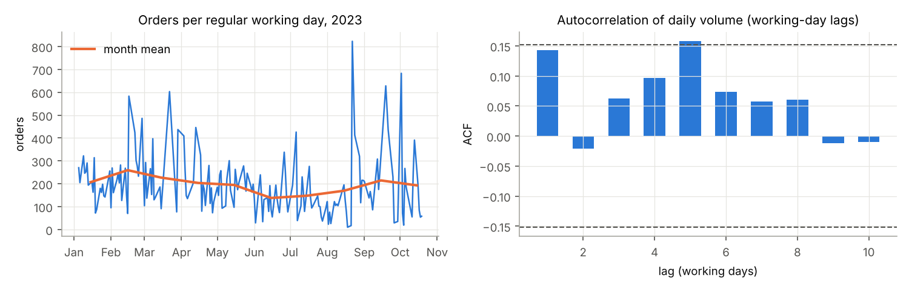
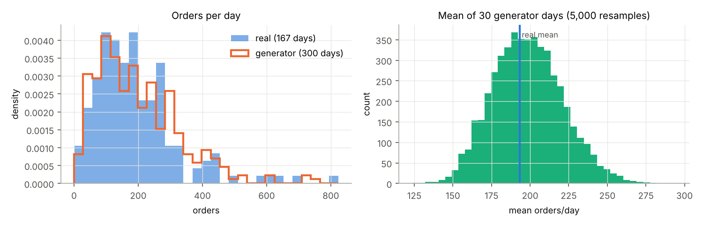
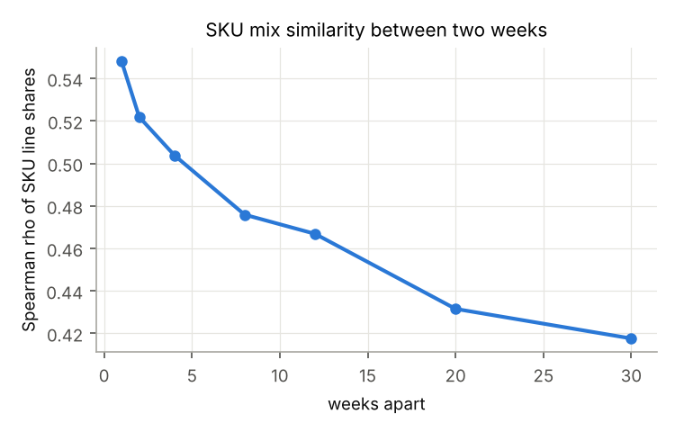

# Input data audit (spec §3.1–3.2): footwear order-fulfilment warehouse

IE305 Simulation Lab. Generated by `python3 -m whsim.input_audit`; do not edit by hand. It checks the assumptions behind the input models in `reports/input_analysis.md` (`whsim.input_models`). **No fitted model or simulation input file is changed by this audit.** Numbers: `reports/input_audit.json`.

**Data.** Mendeley Data pf2w725pw3 v1 (doi:10.17632/pf2w725pw3.1), files in `data_raw/mendeley/`. The second dataset named in the spec (B2FIND / KIT order-picking benchmark) is **not part of this audit**: it could not be downloaded from the analysis environment (host blocked). Its role in the spec is routing verification, not input modelling.

## A. Data audit

| file | rows | cols | missing_cells | note |
|---|---|---|---|---|
| Class_Based_Storage.csv | 2341 | 20 | 0 |  |
| Customer_Order.csv | 122370 | 9 | 16 |  |
| Dedicated_Storage.csv | 2340 | 20 | 0 |  |
| Hybrid_Storage.csv | 2340 | 20 | 0 |  |
| Picking_Wave.csv | 215192 | 6 | 0 |  |
| Product.csv | 208 | 3 | 0 |  |
| Random_Storage.csv | 2292 | 19 | 0 |  |
| Storage_Location.csv | 2292 | 5 | 0 |  |
| Support_Points_Navigation.csv | 44 | 2 | 0 |  |

Blank cells are counted after trimming. Customer_Order spans 2023-01-05 07:42:00 to 2023-10-19 07:18:00, timestamp resolution: **minute (seconds always 0)**, 768 distinct stamps for 32,634 orders and 9,784 waves; every order has at most 1 stamp and 100% of waves carry a single stamp.

**Spec §3.1 check: are there line-level pick timestamps?** No. Picking_Wave has no date/time column (none), and the only time in Customer_Order is the order creation minute. Pick time per line therefore cannot be estimated from this dataset and stays an **assumed** input (lognormal mean 12 s, sd 5 s in `run_config.json`), to be varied in the sensitivity analysis. The data-derived upper bound is in `input_analysis.md` §4.6.

## B. Daily volume: independence and stationarity

| test | statistic | p |
|---|---|---|
| ACF lags 1-5 (95% band ±0.15) | +0.14, -0.02, +0.06, +0.10, +0.16 |  |
| Ljung-Box, 10 lags (orders/day) | Q = 12.4 | 0.259 |
| Ljung-Box, 10 lags (log orders/day) | Q = 28.5 | 0.001 |
| runs test above/below median | 76 runs (exp. 84.0), z = -1.25 | 0.213 |
| trend: Spearman(volume, day index) | rho = -0.277 | 2.8e-04 |
| month effect: Kruskal-Wallis | H = 21.8; eta² (log) = 0.13 | 0.010 |
| Ljung-Box on residual after month + weekday | Q = 13.6; lag-1 = +0.08 | 0.191 |

Month means (orders/day): Jan 207, Feb 259, Mar 227, Apr 204, May 195, Jun 138, Jul 148, Aug 170, Sep 214, Oct 193.

**Reading.** Day-to-day dependence: after removing the month and weekday levels the residual is white noise (Ljung-Box p = 0.191); the raw counts show no significant short-range autocorrelation either (p = 0.259); the largest single lag is lag 5 (one working week, ACF +0.16), i.e. the weekday effect already in `input_analysis.md` §5.1. There is, however, a slow **seasonal level**: the month explains 13% of the variance of log volume (Kruskal-Wallis p = 0.010), month means range 138–259 orders/day, and volume declines over the year (Spearman rho = -0.28). The log-scale Ljung-Box (p = 0.001) picks up this level shift, not day-to-day memory. **Consequences:** (i) for one-day terminating replications, drawing each day i.i.d. from the fitted negative binomial is correct: it is the marginal distribution of a 2023 working day; (ii) a multi-day run with stock carried over should hold the month level fixed within the run; (iii) peak scenarios can be anchored on the data: the busiest month (Feb) is 1.33× and the quietest (Jun) 0.71× the average month.

## C. Daily volume: discrete Anderson-Darling with parametric bootstrap

The KS and chi-square tests in `input_models.json` are complemented with the Anderson-Darling statistic for discrete distributions (Choulakian, Lockhart & Stephens 1994), which weights the tails. The p-value comes from a parametric bootstrap with the parameters re-estimated on each of 300 samples (spec §3.2 step 5).

| family | A² | p (bootstrap) | parameters |
|---|---|---|---|
| poisson | 760.690 | 0.003 | lam = 193.2 |
| nbinom | 0.469 | 0.262 | r = 2.383, p = 0.01218, mean = 193.2 |
| lognormal | 1.635 | 0.003 | mu = 5.035, sigma = 0.7308 |
| gamma | 0.482 | 0.213 | shape = 2.339, scale = 82.61 |

Passing at 5%: nbinom, gamma. The chosen negative binomial is confirmed by a tail-sensitive test.

## D. Generator: large-sample check

The first version of `input_analysis.md` §7 validated the generator on 30 synthetic days (seeds 1001..1030) and reported orders/day 156 vs 193 (KS p = 0.050), which looked like a bias. Here the same generator (`input_models.make_synthetic_day`) is run on 300 independent seeds (5001..5300).

| per day | real mean (sd) | generator mean (sd) | generator mean 95% CI | KS p | mean of 30 days, 5–95% |
|---|---|---|---|---|---|
| orders | 193.2 (130.4) | 198.3 (131.6) | 183–213 | 0.321 | 163–237 |
| lines | 686.2 (489.4) | 685.2 (458.5) | 633–737 | 0.807 | 561–823 |
| units | 1287.2 (981.1) | 1352.3 (1110.1) | 1227–1478 | 0.861 | 1069–1692 |

**Reading.** With 300 days the generator's mean volume (198) matches the real mean (193). A mean of 30 generator days falls anywhere in 163–237 (90% range), so the 156 in §7 was sampling noise of a small validation sample, not a bias. Even 200-seed blocks are noisy: seeds 1001..1200, 1201..1400 and 1401..1600 give orders/day KS p = 0.049, 0.88 and 0.44. `VALID_SEEDS` in `input_report.py` is therefore set to 1,000 days (seeds 1001..2000; orders/day 198 vs 193, KS p = 0.42).

## E. Baskets: stationarity, dependence and SKU-mix drift

- **Lines per order by month:** Jan 2.88, Feb 2.62, Mar 3.37, Apr 3.82, May 4.35, Jun 3.82, Jul 3.93, Aug 3.47, Sep 3.71, Oct 4.36. The mean rises from 2.6 to 4.4 lines (Kruskal-Wallis p = 7.7e-94), yet the month explains only 1.4% of the variance of log lines/order: the order-to-order spread dominates. The window bootstrap draws baskets from the anchor day's own ±3 days, so it inherits the month's basket size automatically; a whole-year bootstrap would not.
- **Order-to-order dependence:** lag-1 correlation of lines/order between consecutive orders of a day, median over 166 days = +0.00 (mean +0.02): basket sizes of successive orders are independent, as the bootstrap assumes. 40% of consecutive orders come from the same customer (a customer's orders are released together). The bootstrap does not reproduce that customer clustering; it only affects which orders share a cart, not the volume or the basket sizes.
- **SKU-mix drift:** Spearman correlation of weekly SKU line shares, by distance in weeks: 1 wk 0.55, 2 wk 0.52, 4 wk 0.50, 8 wk 0.48, 12 wk 0.47, 20 wk 0.43, 30 wk 0.42. The mix decays steadily (seasonal collections). A whole-year bootstrap would give 384 distinct SKUs per day for the real number of lines, against 320 in reality (×1.20). This is the quantitative case for the ±3-day window bootstrap in `input_models` and for slotting from the same period as the demand.

## F. Picker heterogeneity

Lines per operator-day for the 13 operators with at least 20 working days (1044 operator-days): Kruskal-Wallis on log lines p = 1.6e-11; intraclass correlation 0.07 (share of the variance of log lines that is between operators). Relative to an equal split of the day's lines among that day's operators, an operator's average share ranges 0.58–1.30 (CV 0.20). Most of the variation is therefore day-to-day workload, not the operator. These differences mix speed with task allocation (some operators also pack or receive), so they are **not** a speed estimate. The model's pickers are identical; a per-picker speed factor drawn once per day (e.g. lognormal, sd ≈ the between-operator sd on the log scale, 0.27) is the natural sensitivity case.

## Summary for the model

| input | finding | action |
|---|---|---|
| pick time per line | no pick timestamps in the data | stays assumed; sensitivity 8–20 s |
| daily volume | NB marginal passes AD; days are independent day to day, with a month level | keep i.i.d. NB for one-day replications; peak scenarios from month means |
| synthetic-day generator | unbiased over 300 days | validation now on 1,000 days (VALID_SEEDS) |
| baskets | size and SKU mix vary by month; orders independent | keep ±3-day window bootstrap |
| pickers | between-operator ICC 0.07 | optional picker-speed-factor sensitivity |
