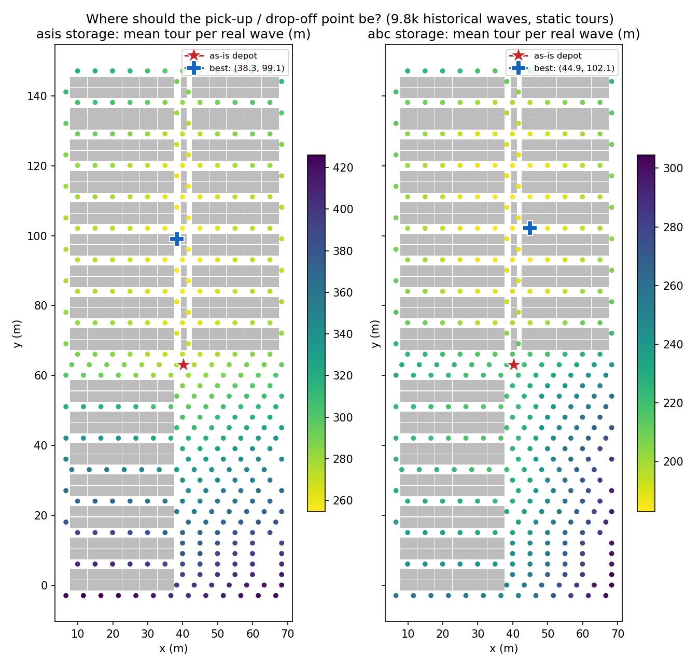
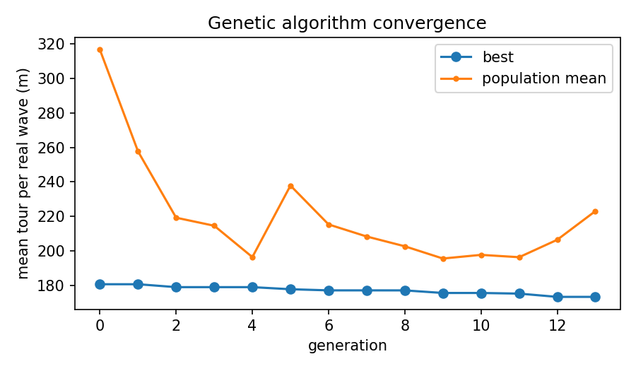
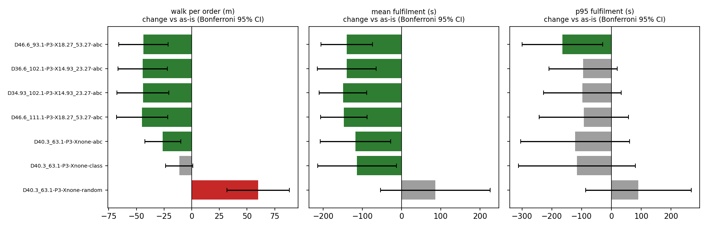
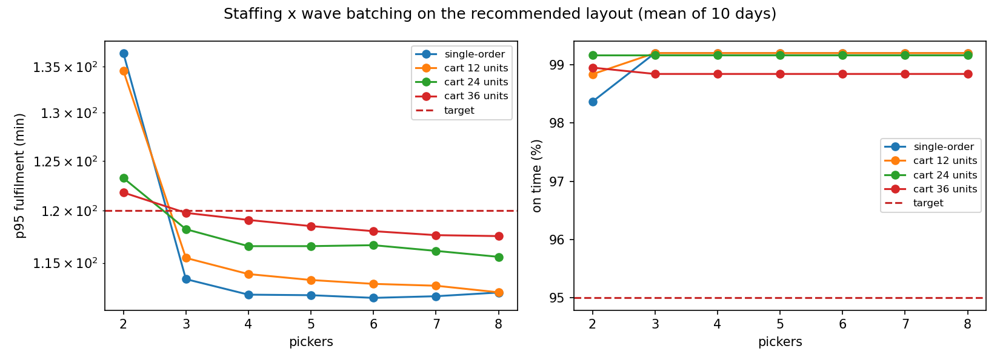

# Simulation-based optimisation

All numbers come from `python3 -m whsim.optimize` (results/opt/). Designs are named by their coordinates: `D<x>_<y>` = depot position in metres (dataset frame), `P` = packing stations, `X` = extra cross aisles (x in metres, `none` = as built), last part = storage policy.

## Stage 1 - screening on the real historical waves

Static objective: mean tour length of the 9.8k historical picking waves (real cart contents) on each layout. The genetic algorithm evaluated 251 distinct designs; best: `D46.6_111.1-P3-X18.27_53.27-abc`.

| as-is layout, storage policy | mean tour per wave (m) |
|---|---|
| D40.3_63.1-P3-Xnone-asis | 275.2 |
| D40.3_63.1-P3-Xnone-random | 445.8 |
| D40.3_63.1-P3-Xnone-class | 254.6 |
| D40.3_63.1-P3-Xnone-abc | 221.0 |

## Stage 2 - DES ranking (10 synthetic days, common random numbers)

| design | walk / order (m) | tour (s) | fulfil mean (s) | fulfil p95 (s) | on time (%) | picker util |
|---|---|---|---|---|---|---|
| D40.3_63.1-P3-Xnone-asis (as-is) | 113.2 | 705 | 3716 | 7061 | 99.1 | 0.07 |
| D40.3_63.1-P3-Xnone-random | 173.3 | 975 | 3803 | 7152 | 99.4 | 0.10 |
| D40.3_63.1-P3-Xnone-class | 101.9 | 660 | 3603 | 6945 | 99.5 | 0.07 |
| D40.3_63.1-P3-Xnone-abc | 87.1 | 593 | 3599 | 6939 | 99.5 | 0.06 |
| D46.6_111.1-P3-X18.27_53.27-abc **(recommended)** | 68.4 | 508 | 3569 | 6968 | 99.2 | 0.05 |
| D34.93_102.1-P3-X14.93_23.27-abc | 69.1 | 509 | 3567 | 6963 | 99.2 | 0.05 |
| D36.6_102.1-P3-X14.93_23.27-abc | 69.0 | 508 | 3577 | 6966 | 99.2 | 0.05 |
| D46.6_93.1-P3-X18.27_53.27-abc | 69.6 | 517 | 3577 | 6897 | 99.4 | 0.05 |

Paired difference vs the as-is layout (same days, same service-time streams), Bonferroni 95% CI:

| design | walk / order (m) | fulfil mean (s) |
|---|---|---|
| D40.3_63.1-P3-Xnone-random | +60.1 ± 28.2 | +86 ± 140 |
| D40.3_63.1-P3-Xnone-class | -11.3 ± 12.3 | -113 ± 101 |
| D40.3_63.1-P3-Xnone-abc | -26.1 ± 16.2 | -118 ± 90 |
| D46.6_111.1-P3-X18.27_53.27-abc | -44.8 ± 23.1 | -147 ± 59 |
| D34.93_102.1-P3-X14.93_23.27-abc | -44.1 ± 23.4 | -150 ± 60 |
| D36.6_102.1-P3-X14.93_23.27-abc | -44.2 ± 22.3 | -140 ± 75 |
| D46.6_93.1-P3-X18.27_53.27-abc | -43.6 ± 22.4 | -140 ± 66 |

## Stage 3 - pickers and wave batching

Fewest pickers meeting on-time >= 95% and p95 fulfilment <= 120 min, then least walking: **3 pickers** with **36-unit carts** (on time 98.8%, p95 120 min, 9.1 km walked per day).

## Stage 4 - robustness to the assumed pick time

| pick time x | as-is fulfil mean (s) | recommended fulfil mean (s) | difference (Bonferroni 95% CI) |
|---|---|---|---|
| 0.5 | 3656 | 3518 | -138 ± 35 |
| 1.0 | 3716 | 3569 | -147 ± 39 |
| 1.5 | 3760 | 3621 | -139 ± 66 |
