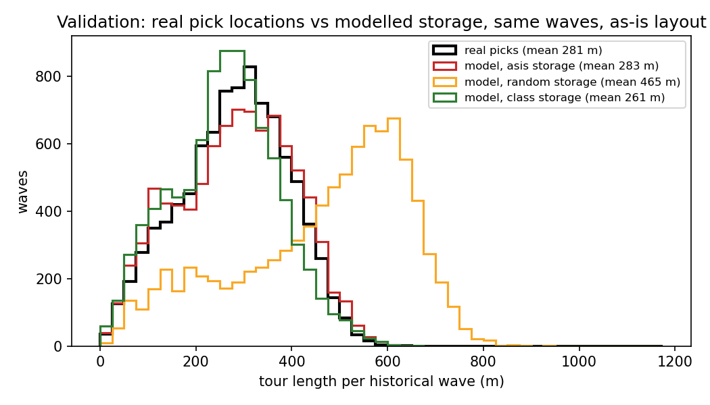

# Validation of the as-is model against the real picks

Units in Picking_Wave.csv: 215,192; placed on a modelled bay: 191,583 (89.0%; the rest are at locations without coordinates, e.g. 'RC-..', or on the overhead bays). Waves compared: 9,143.

| tours of the same historical waves | mean (m) | median (m) | p95 (m) |
|---|---|---|---|
| real pick locations | 280.7 | 286.7 | 456.0 |
| model, asis storage | 283.1 | 288.7 | 470.7 |
| model, random storage | 464.5 | 508.0 | 694.0 |
| model, class storage | 261.1 | 266.0 | 443.3 |
| model, abc storage | 226.9 | 226.0 | 400.0 |

